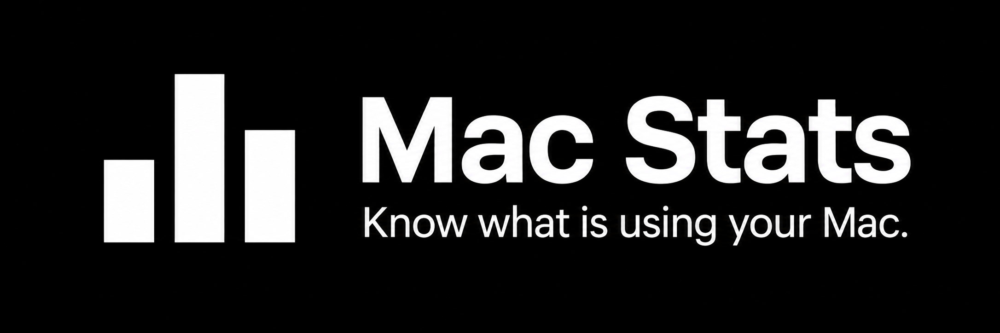

Mac Stats is a small native macOS menu bar utility for seeing total CPU usage and which apps or command-line tools are responsible.

Click the CPU percentage in the menu bar to see a minute of CPU history and usage by app. Search for Codex, Claude, another app, or a process. Each row pairs a usage bar with its exact percentage. Expand a group to inspect its processes. Stop opens a native confirmation with Quit and Force Quit; the app rechecks the process identity before sending a signal. Settings include launch at login and update checks. There are no web views, telemetry, accounts, or continuous animations.

Signed, notarized downloads are distributed through [GitHub Releases](https://github.com/ParkerRex/mac-stats/releases). Unzip the app, move it to Applications, and open it. The release archive supports Apple silicon and Intel; runtime validation was performed on Apple silicon with macOS 27.0.1. See [validation](docs/VALIDATION.md) for measured performance and remaining limits.

## Build and run

Requires macOS 14 or later and a Swift 6 toolchain. Install Xcode or its Command Line Tools. Sparkle 2.10.0 is the only external package and is pinned in `Package.resolved`.

```sh
git clone https://github.com/ParkerRex/mac-stats.git
cd mac-stats
swift test
swift build -c release
scripts/package_app.sh
open "dist/Mac Stats.app"
```

The script builds the release executable, embeds Sparkle, adds the icon and app metadata, and signs the bundle ad hoc by default. It also produces `dist/Mac-Stats-0.1.0.zip`, a local development archive. The app runs only in the menu bar. Use Settings to enable launch at login. For local installation, copy `dist/Mac Stats.app` into `/Applications`, then open that copy. Local ad hoc signing does not provide the trust of a Developer ID signed and notarized release.

To build for both Apple silicon and Intel:

```sh
UNIVERSAL=1 scripts/package_app.sh
```

To regenerate the checked-in icon after changing its source:

```sh
scripts/create_app_icon.sh
```

## CPU and attribution

100% means all logical CPUs are fully busy. A process using one full logical CPU on a 12-CPU Mac shows about 8.3%. This differs from Activity Monitor's per-core process convention, where the same process shows about 100%. Whole-machine CPU comes from system CPU counters; process CPU comes from the change in each process's accumulated CPU time. The totals can differ because sampling and process visibility differ.

The app groups processes using executable paths, app bundle identity, and visible parent processes. It recognizes Codex, Claude, and selected other tools. Descendant work remains in its tool group while ancestry is visible. Ordinary apps and unclassified processes remain visible. It does not infer ownership from command contents or AI output. Reparented children, shell scripts, shared services, inaccessible processes, and short-lived work can limit attribution. A group is the observed set of processes, not a promise that every resource used by an app is represented.

System CPU is sampled every two seconds while the popover is closed. Detailed process sampling runs once per second while it is open. Sampling pauses during sleep and resets after wake. The first sample establishes a baseline. History uses only measured values on a fixed 0–100% scale. Row order stays stable while you select, expand, or search; readings keep updating. The app does not sample the GPU or report memory pressure.

Termination is limited to eligible processes owned by the current user. The app refuses protected system processes, itself, and stale process identities. Quit sends SIGTERM; Force Quit sends SIGKILL. A process can exit during an action, and macOS does not provide an atomic identity-checked signal API. Group actions can therefore partially complete; see [validation and limitations](docs/VALIDATION.md).

## Updates and privacy

Release builds use signed Sparkle updates, with the feed hosted on GitHub Releases. Automatic checks are off until enabled in Settings. Scheduled discovery adds a quiet reminder to the app; Options → Check for Updates opens Sparkle's native installation interface. Automatic installation and web-based release notes are disabled. Development bundles without an HTTPS feed and Ed25519 public key disable the updater and explain why.

Process data stays on the Mac. Mac Stats does not transmit process names, paths, CPU samples, or usage analytics. Configured Sparkle checks contact the update feed and download host; those servers can receive standard network information such as the client's IP address. Sparkle system profiling is disabled.

## Project structure

- `Sources/ProcessCore`: native sampling, attribution, CPU calculations, and guarded termination.
- `Sources/MacStats`: AppKit menu bar, popover, settings, and Sparkle integration.
- `Sources/ProcessProbe`: command-line integration checks and measurements.
- `Tests/ProcessCoreTests`: focused behavior tests.
- `scripts`: local icon generation and app packaging. No recurring GitHub Actions are required.

Measured overhead and test evidence belong in [docs/VALIDATION.md](docs/VALIDATION.md). The design and intended scope are recorded in [docs/STRATEGY.md](docs/STRATEGY.md), with [Apple HIG review criteria](docs/NATIVE-DESIGN.md).

Mac Stats is [MIT licensed](LICENSE), copyright 2026 Parker Rex. Sparkle and its bundled components have their own notices; packaging includes the complete Sparkle license in the app's resources. See [Sparkle's license](https://github.com/sparkle-project/Sparkle/blob/2.10.0/LICENSE).
